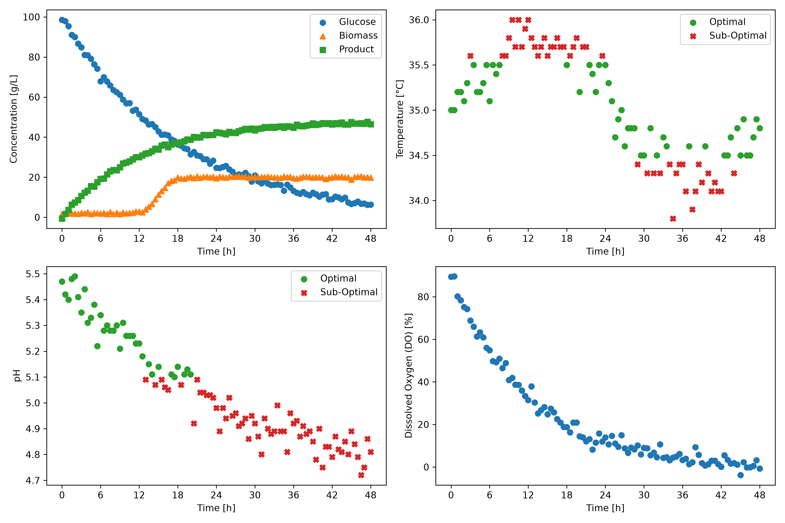

# Fermentation Monitor 
A Python application that analyzes fermentation batch data, generates monitoring dashboards, and produces summary tables for batch performance evaluation.

## Overview
The goal of this project is to automate the analysis of fermentation process data using a custom Python class called `BioprocessMonitor`. 
The program processes fermentation batch data, identifies if operating conditions remain within acceptable ranges, 
generates dashboard visualizations for each batch, and exports summary tables that can be used to compare batch performance.

## Features

The `BioprocessMonitor` class can:

- Load and organize fermentation batch data.
- Extract data for individual batches and evaluate them using two sets of operating limits (Modes A and B).
- Determine whether pH and temperature measurements are within acceptable operating ranges.
- Generate dashboard figures showing process variables over time.
- Export summary tables containing key performance metrics for each batch.

## Technologies Used 

This project was developed using:

- Python 3.14.7
- pandas 3.0.5
- Matplotlib 3.11.0

## Code Design

Running

```bash
python main.py
```
executes the `BioprocessMonitor` class to process the fermentation dataset. 
The program automatically analyzes every fermentation batch, creates dashboard figures for each batch and operating mode, and exports summary tables containing performance metrics. 
All generated figures are saved in the `figures` directory, while summary tables are saved in the `tables` directory.

## Dashboard

### Example Dashboard



This dashboard displays the fermentation profile for a single batch. It includes glucose, biomass, and product concentrations over time, as well as temperature, pH, and dissolved oxygen measurements.
In the temperature and pH plots, green circles represent measurements within the acceptable operating limits, including the boundaries, while red X markers represent measurements outside those limits. 
This dashboard shows Batch 1 evaluated using Mode B, with an acceptable pH range of 5.1–5.5 and a temperature range of 34.5–35.5 °C.

## Summary Table

### Example Summary Table - Mode A
|batch_id|ph_optimal_percent           |temperature_optimal_percent|C_product_g_L^-1_final                       |
|--------|-----------------------------|---------------------------|---------------------------------------------|
|1       |93.81                        |97.94                      |46.5                                         |
|2       |96.69                        |97.52                      |50.8                                         |
|3       |95.89                        |93.15                      |44.6                                         |
|4       |100.0                        |96.47                      |48.6                                         |
|5       |48.62                        |99.08                      |24.7                                         |

The summary table gives an overview of each fermentation batch by reporting the percentage of measurements that pH and temperature remained within their acceptable operating ranges, along with the final product concentration. 
These metrics allow batches to be compared efficiently.